<p align="center">
  
</p>
<h1 align="center">Pocket Day</h1>
<p align="center">
  A journal that writes itself. One page per day: <b>your own words</b> on top, and underneath, what the other apps on your server already know about it — where you were, the photos you took, what played, what you watched, read, cooked and spent.<br>
  <b>One binary · one SQLite file · one volume.</b>
</p>
<p align="center">
  <a href="https://github.com/abjelosevic88/pocket-homelab-day/actions"></a>
  <a href="https://github.com/abjelosevic88/pocket-homelab-day/pkgs/container/pocket-homelab-day"></a>
  <a href="LICENSE"></a>
</p>

---

A self-hosted server already records your life in pieces: Dawarich has the route, Immich the photos, Maloja the songs, PinePods and Audiobookshelf what you listened to, Jellystat the episodes, Forgejo the commits, Nextcloud the tasks, Pocket Documents the letters, Pocket Money the receipts, the other Pocket apps the habits, books, trips and dinners. Nobody puts them on one page. Pocket Day does, and gives you one line a day to say what it meant.

- **Today, filled in.** Every 30 minutes today and yesterday are pulled from every connected app. Open the page in the evening and the day is already there: kilometres and stops, a photo grid, the listening and watching, the check-in, the book you finished, what you cooked and spent, the weather where you were.
- **One line, then more if you like.** A highlight, a free text, a mood from 😖 to 😄 and tags. Autosaves while you type.
- **Moments.** Short timestamped lines through the day — a win, a thank-you, an idea — from the page, a Siri Shortcut or Raycast.
- **Keep what mattered.** Star a photo, a song, a place, a transaction or a book and it sits at the top of the day.
- **Frozen in time.** Past days are fetched once and kept. The journal still reads when a source is gone or its data rotated away.
- **Memories.** The same date in earlier years shows on the day page and in the morning push.
- **Calendar, journal, year.** A month grid coloured by mood with photos/km/listens per day; a searchable journal; a year in review with month bars, moods by weekday, most played, most watched, books, places, trips and the days you starred.
- **AI, if you want it.** Add an OpenAI key and the day page drafts your entry from what the apps recorded, asks one specific question about the day, suggests a highlight, tags and mood, and takes dictation. Weeks, months and years get written up as stories, and you can ask the journal things like “when was I last at the lake?” and get an answer that links the days.
- **Two pushes a day.** An evening “How was today?” with the day's numbers (skipped once you wrote), a morning “On this day”. Apprise, ntfy or a webhook.

<p align="center">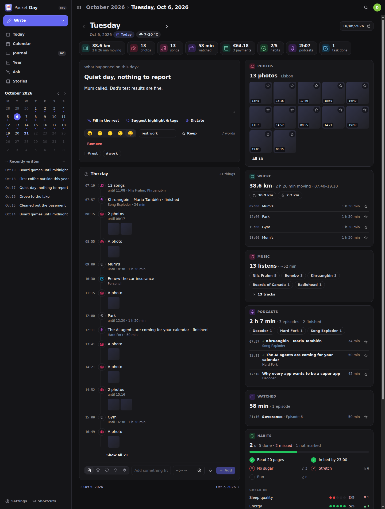</p>

<table>
  <tr>
    <td width="50%">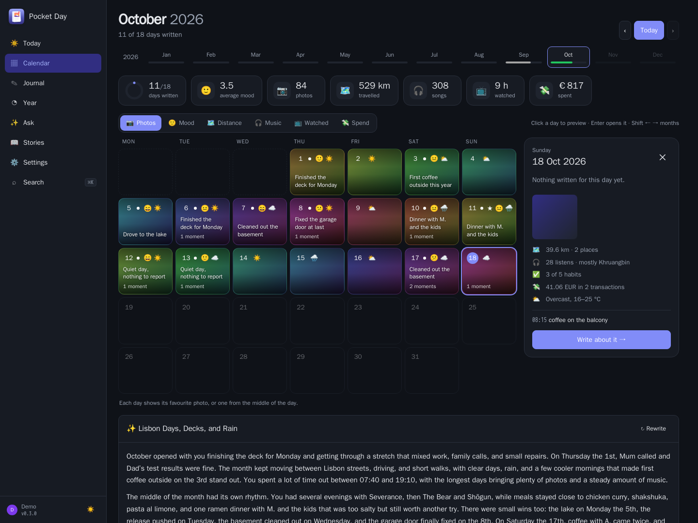</td>
    <td width="50%">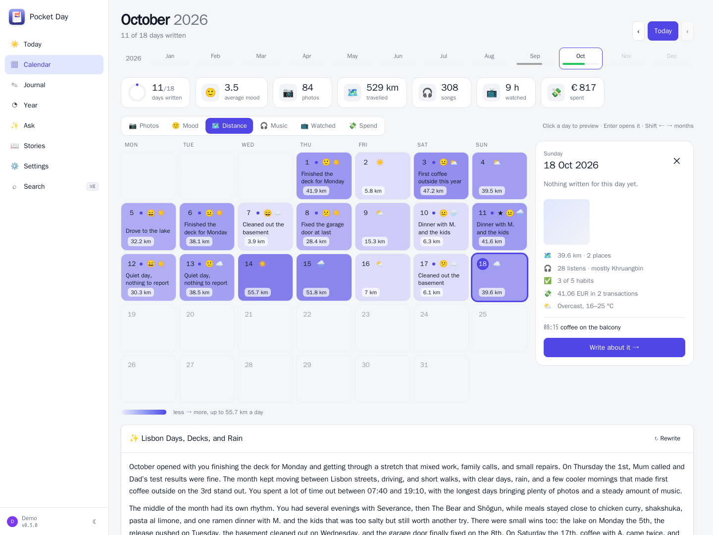</td>
  </tr>
  <tr>
    <td align="center"><sub>Calendar: every day behind its best photo, a preview without leaving the month.</sub></td>
    <td align="center"><sub>…or coloured by podcasts, audiobooks, commits, tasks, mood, distance, music, watching or spending.</sub></td>
  </tr>
  <tr>
    <td width="50%">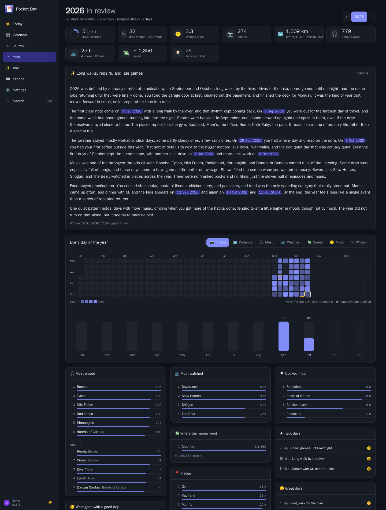</td>
    <td width="50%">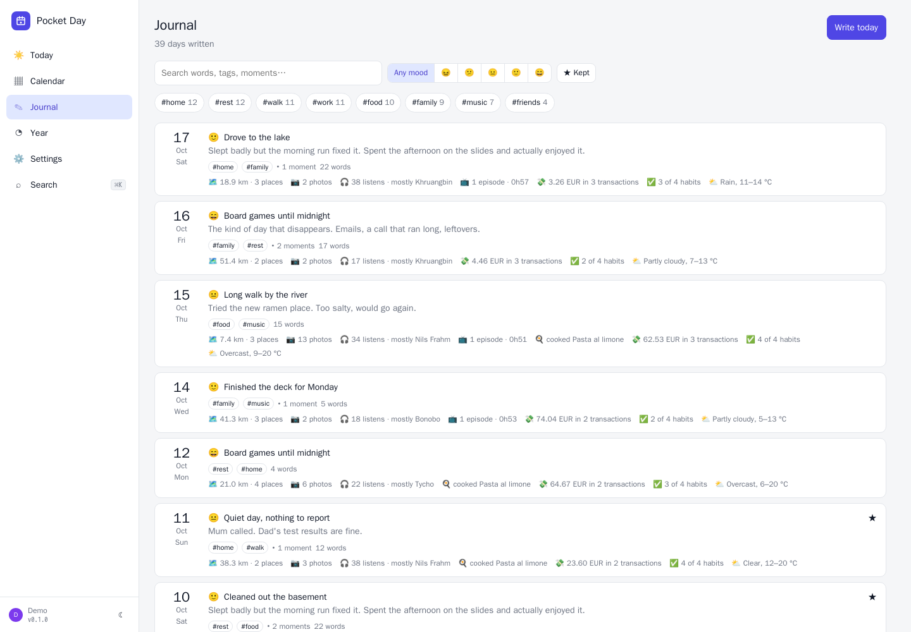</td>
  </tr>
  <tr>
    <td align="center"><sub>Year: the story, every day as a heatmap, month bars, most played, money by category.</sub></td>
    <td align="center"><sub>Journal: search your words, filter by mood or tag.</sub></td>
  </tr>
  <tr>
    <td width="50%">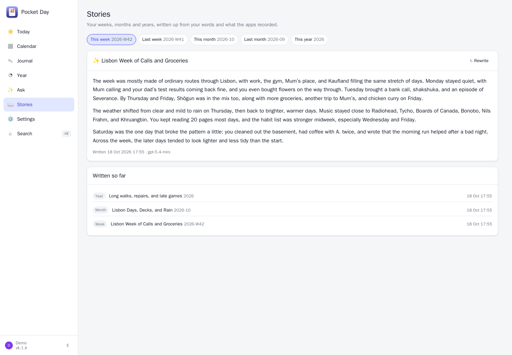</td>
    <td width="50%">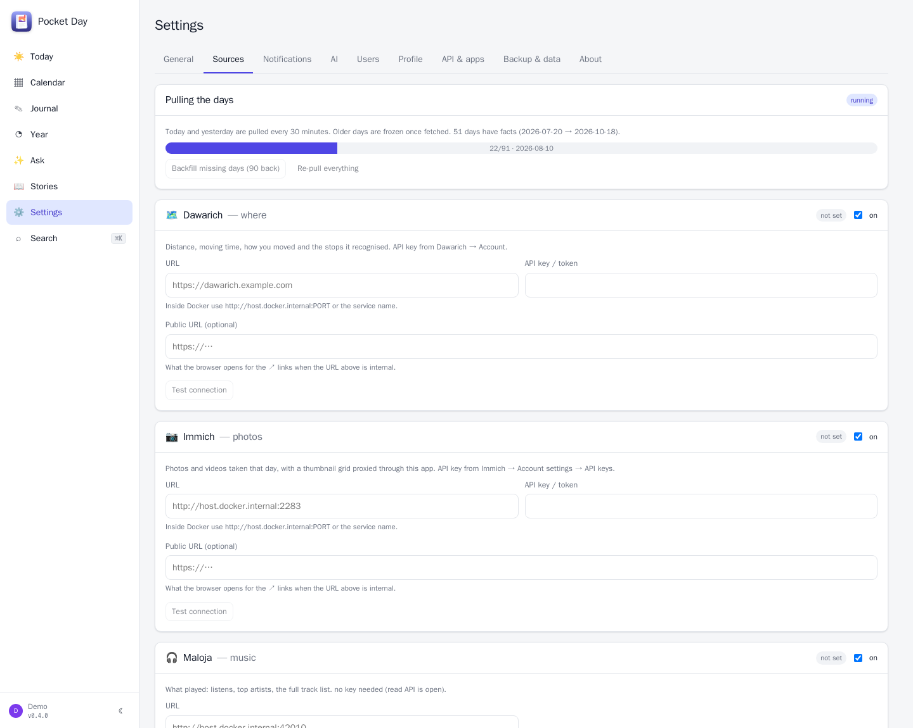</td>
  </tr>
  <tr>
    <td align="center"><sub>Stories: weeks, months and years written up from your days.</sub></td>
    <td align="center"><sub>Sources: connect what you run, test, backfill.</sub></td>
  </tr>
</table>

<p align="center">
  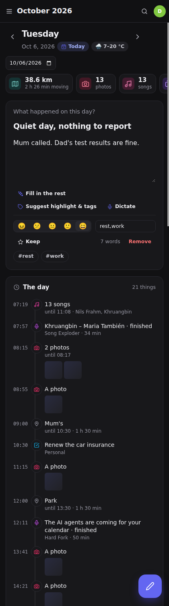&nbsp;&nbsp;
  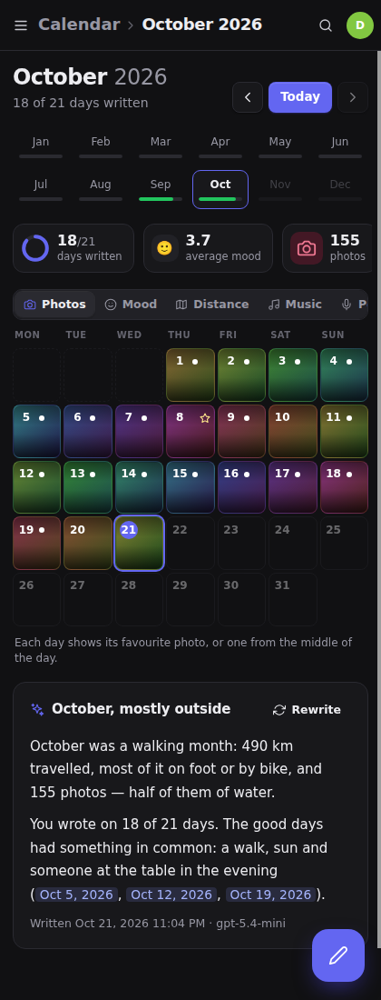
</p>

## Sources

| Source | What lands on the day | Needs |
|---|---|---|
| **Dawarich** | distance, moving time, distance per mode, recognised stops | Pocket Core service, or URL + API key |
| **Immich** | photos and videos of the day as a thumbnail grid (proxied), places | Pocket Core service, or URL + API key |
| **Maloja** | listens, top artists, full track list | Pocket Core service, or URL |
| **Jellystat** | episodes and films watched, minutes (optionally one Jellyfin user) | Pocket Core service, or URL + API key |
| **Pocket Money** | withdrawals with categories, totals per currency, read from its Firefly-compatible API; with Pocket Money's webhook a booking shows up within seconds (`MONEY_WEBHOOK_SECRET`) | Pocket Core link, or its `/firefly` URL + an API token (a Firefly III URL + personal access token works too) |
| **Pocket Habits** | habits done, tracker values, the journal line — and on a day with nothing written here, its journal *is* the entry | Pocket Core link, or URL + token |
| **Pocket Bookshelf** | books being read, started, finished | Pocket Core link, or URL + token |
| **Pocket Travel** | the trip the day fell in, and which day of it | Pocket Core link, or URL + token |
| **Pocket Kitchen** | what was cooked | Pocket Core link, or URL + token |
| **Pocket Garage** | fill-ups and service records | Pocket Core link, or URL + token |
| **PinePods** | podcast episodes and minutes per day (spread-out episodes count on each day) | Pocket Core service, or URL + API key |
| **Audiobookshelf** | audiobook and ABS-podcast listening sessions, per title | Pocket Core service (your own ABS account, or the box's admin key for an admin), or URL + admin API key |
| **Jellyseerr** | films and series requested, and when they became available | Pocket Core service, or URL + API key |
| **Forgejo** | commits pushed per repository, new repositories, tags, pull requests | Pocket Core service, or URL + read-only token |
| **Nextcloud** | tasks completed (every list), events and contact birthdays, over CalDAV | Pocket Core service, or URL + user + app password |
| **Pocket Documents** | documents added, with correspondent and type, each linking to the document | Pocket Core link, or URL + token |
| **Pocket Invoicing / Split / Inventory** | invoices and payments, shared expenses, stock changes | Pocket Core link, or URL + token |
| **Open-Meteo** | weather at home, or where Dawarich says you were | a home location |

All optional. A day only shows the sources you connected. With **Pocket Core** on the box: registers itself, publishes `day.entry_written`, `day.moment_created` and `day.story_created`, accepts paired-phone tokens, and shows “Sign in with Pocket Core” on the login page with no OIDC configuration at all.

**The Pocket apps through Pocket Core.** Each Pocket app source (Habits, Bookshelf, Travel, Kitchen, Garage, Invoicing, Split, Inventory, Documents, Money) has a connection per person under Settings → Sources: **Pocket Core** (Day reads as you through a Core app link — a fresh five-minute token per fetch, one read-only scope per app, nothing to paste, and every person on the box gets their own), **Direct** (your own URL + API token) or **Off**. Until you choose, a saved token means Direct and otherwise Pocket Core. Switch a link off in Pocket Core (for yourself under Settings → Apps acting for me, or for the box under Links) and the next pull skips that source: the day is not marked failed, Settings says why. The scopes Day asks for: `habits:read`, `books:read`, `trips:read`, `cooklog:read`, `vehicles:read`, `invoices:read`, `groups:read`, `activity:read`, `documents:read`, `transactions:read`. Pocket Documents replaced Paperless-ngx: the days already filled from Paperless keep their documents and show under Pocket Documents; documents brought over from Paperless (or restored from an export) do not count as added on the day of the import.

**The other services through Pocket Core.** Immich, Maloja, Dawarich, Jellystat, PinePods, Audiobookshelf, Jellyseerr, Forgejo and Nextcloud have the same three modes, through Pocket Core *service connections*: Day asks Core for the service's address and your own key there (the box's key only when you are an admin) and keeps neither; the Core SDK reuses the answer for a minute and rides out a Core restart, Test connection always asks afresh. A member with no account of their own in a service is “not connected” and the source is skipped; Settings says whose key a connected one uses. Until you choose, a saved key (for Maloja, a saved URL) means Direct, so an existing setup changes nothing. Filters that are not credentials (the Jellystat and Audiobookshelf users, the Forgejo user name) apply in every mode.

With Pocket Core on the box, Direct is an advanced option (the switch shows Pocket Core | Off, Direct behind “Advanced: connect directly with a URL and key”, or right away if you are on Direct), and Day reports everybody's mode to Core so its Links page shows Direct connections too.

## AI (optional)

Settings → AI takes an OpenAI key (or any OpenAI-compatible endpoint). Default model `gpt-5.4-mini`, dictation `gpt-4o-mini-transcribe`. Without a key every AI button stays hidden.

| Feature | Where | What it does |
|---|---|---|
| **Draft my day** | day page | A first-person draft from the facts, moments and pins — or only the sentences your own text is missing. Never invents feelings. |
| **Tonight's question** | day page, evening push | One question about something concrete in the day (“what took you to the coast?”) instead of the generic prompt. |
| **Suggest** | day page | A highlight, tags from your own tag vocabulary and a mood, from what you wrote. |
| **Dictation** | entry, moments, Ask | 🎙 record in the browser, transcribed and added. |
| **Stories** | Calendar, Year, Stories | The week, month or year as a short story in the second person; the week is pushed on Sunday evening. |
| **Ask your journal** | Ask | Plans a date window and keywords, reads the matching days, answers with linked dates. |
| **What goes with a good day** | Year | Average mood with vs without walks, sun, cooking, photos, TV… — plain arithmetic, shown even without a key. |

The model only ever sees plain-text summaries of the days it needs — never photos — and “Send what I wrote” can keep your own words out of it. Token use per feature is listed under Settings → AI. It writes in the language of your entries unless you set one.

<table>
  <tr>
    <td width="50%">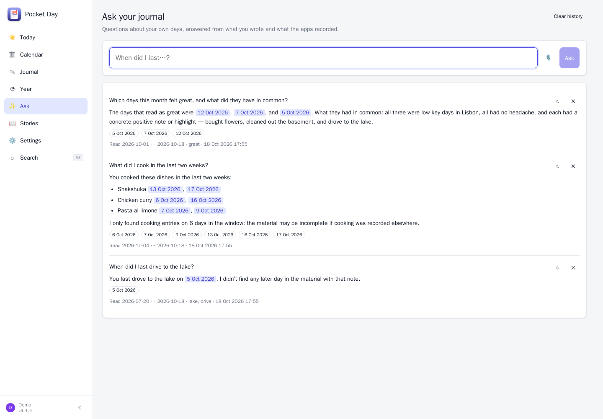</td>
    <td width="50%">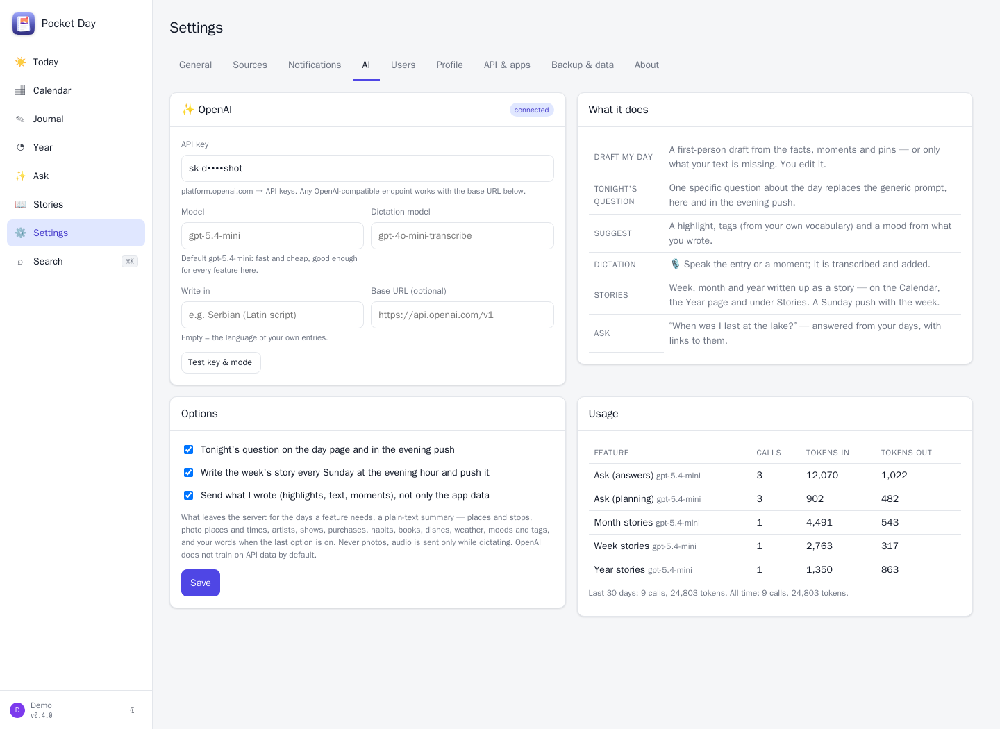</td>
  </tr>
  <tr>
    <td align="center"><sub>Ask: answers with the days they came from.</sub></td>
    <td align="center"><sub>Settings → AI: what is sent, and what it cost in tokens.</sub></td>
  </tr>
</table>

## Run it

```bash
mkdir pocket-day && cd pocket-day
curl -fsSLO https://raw.githubusercontent.com/abjelosevic88/pocket-homelab-day/main/docker-compose.yml
docker compose up -d
# open http://localhost:8080, create your account, then Settings → Sources
```

Or with plain Docker:

```bash
docker run -d --name pocket-day -p 8080:8080 -e TZ=Europe/Berlin -v $PWD/data:/data ghcr.io/abjelosevic88/pocket-homelab-day:latest
```

Or the binary from the [releases](https://github.com/abjelosevic88/pocket-homelab-day/releases): `DATA_DIR=./data ./pocket-day`. A systemd unit is in `deploy/systemd/`.

Set `TZ`: a day is midnight to midnight in that zone. Want to look around first? `DEMO_DATA=true AUTH_MODE=none` seeds six weeks of journal and synthetic facts (the screenshots above are that demo).

## Documentation

- [Configuration](docs/configuration.md) — every environment variable, auth modes, CLI, how facts are pulled and frozen
- [API](docs/api.md) — REST API, the Homepage dashboard, phone-shortcut endpoints
- [Reverse proxy](docs/reverse-proxy.md)
- [Backup & restore](docs/backup.md)
- [Roadmap](docs/roadmap.md)

## Develop

```bash
make dev      # Go API on :8080 with demo data + Vite on :5173
make test     # go vet, go test, tsc
make          # build web/dist and the binary
make docker   # local image
```

Go 1.26 + chi + modernc SQLite (pure Go, no CGO); React 19 + Vite + TypeScript, no UI framework. Source fetchers live in `internal/sources/`, one file each.

## Sibling projects

Pocket Day is one of the Pocket Homelab apps — small single-binary servers that talk to each other, and the one that reads all the others: [Pocket Habits](https://github.com/abjelosevic88/pocket-homelab-habit-tracker), [Pocket Health](https://github.com/abjelosevic88/pocket-homelab-health), [Pocket Inventory](https://github.com/abjelosevic88/pocket-homelab-inventory), [Pocket Bookshelf](https://github.com/abjelosevic88/pocket-homelab-bookshelf), [Pocket Split](https://github.com/abjelosevic88/pocket-homelab-cost-split), [Pocket Clips](https://github.com/abjelosevic88/pocket-homelab-clips), [Pocket Travel](https://github.com/abjelosevic88/pocket-homelab-travel), [Pocket Garage](https://github.com/abjelosevic88/pocket-homelab-garage), [Pocket Kitchen](https://github.com/abjelosevic88/pocket-homelab-kitchen).

## Choosing the AI provider

In Settings, text generation defaults to **Automatic — prefer Pocket AI**.
If Pocket Core reports an enabled link from this app to Pocket AI, generation
uses Pocket AI's Claude account and model for the signed-in person. Otherwise,
automatic mode uses that person's saved OpenAI-compatible configuration. You
can explicitly select **Pocket AI** or **OpenAI**. Standalone installs need no
Pocket Core or Pocket AI and continue to use their own API keys.

Upgrade Pocket AI and this app together. On existing Core installations, approve
the new **Generate text** (`inference:write`) link under **Core → Links**; new
permissions are not automatically granted by an app update. The person's
**Apps acting for me** switch must also be enabled. Existing opt-outs are
preserved. Every generation request obtains a fresh, person-scoped token.

Core outages and Pocket AI generation failures are reported without silently
retrying against OpenAI. Pocket AI runs a text-only, temporary Claude session
without tools, filesystem access, MCP servers or saved conversation history.
The model and Claude account come from the person's Pocket AI settings.

Dictation remains separate: it requires the person's OpenAI-compatible key and
audio-transcription endpoint, even when Pocket AI generates text.

Pocket AI model selection: AI settings offer the models discovered from your connected Claude account. “Use Pocket AI default” follows your current model in Pocket AI (Sonnet when no model is set). An explicit choice is saved per person in this app and never changes the Pocket AI default or your OpenAI model. Loading models does not create a chat or send a generation prompt. If a saved model is no longer offered, choose another model or return to the default; generation does not silently substitute a different model.
